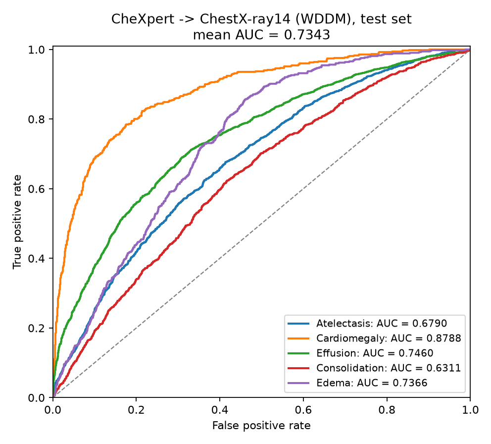
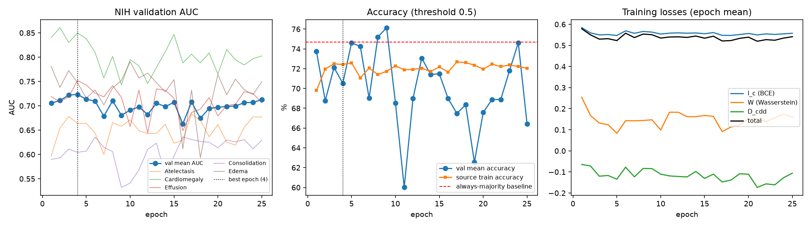

# WDDM: CheXpert → ChestX-ray14 results

Reimplementation of He et al., *Sci Rep* 14:2690 (2024). Source: CheXpert-v1.0-small
(labeled, 138,757 images). Target: ChestX-ray14 (NIH), labels not used for training.
Evaluated on a held-out, patient-disjoint NIH test split (5,425 images,
1,608 patients) with the checkpoint of the best validation
epoch (epoch 4 of 25, validation mean AUC 0.7234),
as in the paper.

## Test results vs the paper

| 5-lesion mean (%) | AUC | Accuracy | Sensitivity | Specificity | PPV | NPV |
|---|---|---|---|---|---|---|
| Paper Exp 2: CheXpert -> ChestX-ray14, no adaptation | 62.7 | 58.7 | 58.4 | 59.9 | 31.5 | 79.6 |
| Paper Exp 3: CheXpert -> ChestX-ray14, WDDM | 80.5 | 74.3 | 73.8 | 74.4 | 45.3 | 87.2 |
| This run: CheXpert -> ChestX-ray14, WDDM | 73.4 | 70.1 | 48.1 | 78.6 | 44.7 | 81.8 |

95% patient-level bootstrap CIs (1000 resamples): AUC 73.4 [72.2, 74.7], Accuracy 70.1 [69.2, 71.0], Sensitivity 48.1 [46.5, 49.8], Specificity 78.6 [77.6, 79.5].

## Per-lesion test results (threshold 0.5)

| Lesion | AUC | Accuracy | Sensitivity | Specificity | PPV | NPV | Prevalence | Majority-class acc. |
|---|---|---|---|---|---|---|---|---|
| Atelectasis | 67.9 | 60.1 | 10.8 | 96.3 | 68.4 | 59.5 | 42.4 | 57.6 |
| Cardiomegaly | 87.9 | 90.2 | 57.9 | 93.6 | 49.7 | 95.4 | 9.8 | 90.2 |
| Effusion | 74.6 | 66.7 | 76.9 | 57.6 | 61.9 | 73.6 | 47.2 | 52.8 |
| Consolidation | 63.1 | 81.3 | 4.7 | 97.4 | 27.5 | 83.0 | 17.3 | 82.7 |
| Edema | 73.7 | 52.3 | 90.0 | 48.2 | 15.8 | 97.8 | 9.7 | 90.3 |

Accuracy has to be read against the "majority-class" column: always predicting the
more common answer for each lesion already scores 74.7% on average,
because Cardiomegaly, Consolidation and Edema are rare. AUC is threshold-free and is the
metric used for model selection.

## Training history (NIH validation set)

| Epoch | Val AUC | Val acc (%) | Source train acc (%) | l_c | W | D_cdd |
|---|---|---|---|---|---|---|
| 1 | 0.7054 | 73.73 | 69.80 | 0.5844 | +0.2539 | -0.0646 |
| 2 | 0.7108 | 68.78 | 71.96 | 0.5593 | +0.1670 | -0.0719 |
| 3 | 0.7221 | 72.11 | 72.49 | 0.5498 | +0.1318 | -0.1202 |
| 4 **best** | 0.7234 | 70.52 | 72.42 | 0.5516 | +0.1241 | -0.1168 |
| 5 | 0.7135 | 74.62 | 72.59 | 0.5473 | +0.0832 | -0.1347 |
| 6 | 0.7097 | 74.25 | 71.08 | 0.5691 | +0.1428 | -0.0775 |
| 7 | 0.6786 | 69.02 | 72.06 | 0.5575 | +0.1426 | -0.1233 |
| 8 | 0.7102 | 75.21 | 71.40 | 0.5663 | +0.1440 | -0.0835 |
| 9 | 0.6806 | 76.15 | 71.74 | 0.5631 | +0.1473 | -0.0842 |
| 10 | 0.6911 | 68.54 | 72.28 | 0.5540 | +0.0990 | -0.1106 |
| 11 | 0.6978 | 60.01 | 71.89 | 0.5582 | +0.1832 | -0.1189 |
| 12 | 0.6821 | 68.99 | 71.93 | 0.5595 | +0.1830 | -0.1216 |
| 13 | 0.7056 | 73.06 | 72.05 | 0.5579 | +0.1622 | -0.1237 |
| 14 | 0.6983 | 71.42 | 71.72 | 0.5591 | +0.1620 | -0.0976 |
| 15 | 0.7072 | 71.49 | 72.18 | 0.5554 | +0.1678 | -0.1308 |
| 16 | 0.6628 | 68.98 | 71.66 | 0.5609 | +0.1636 | -0.1103 |
| 17 | 0.7077 | 67.48 | 72.68 | 0.5479 | +0.0913 | -0.1476 |
| 18 | 0.6743 | 68.35 | 72.61 | 0.5473 | +0.1130 | -0.1386 |
| 19 | 0.6949 | 62.55 | 72.36 | 0.5516 | +0.1218 | -0.1087 |
| 20 | 0.6968 | 67.58 | 71.95 | 0.5566 | +0.1541 | -0.1108 |
| 21 | 0.6988 | 68.88 | 72.46 | 0.5499 | +0.1517 | -0.1733 |
| 22 | 0.6995 | 68.89 | 72.22 | 0.5546 | +0.1381 | -0.1566 |
| 23 | 0.7065 | 71.80 | 72.38 | 0.5521 | +0.1570 | -0.1612 |
| 24 | 0.7069 | 74.62 | 72.21 | 0.5550 | +0.1736 | -0.1274 |
| 25 | 0.7130 | 66.41 | 72.04 | 0.5577 | +0.1605 | -0.1057 |

## Setup

| Setting | Value |
|---|---|
| Backbone | BiFormer-B, ImageNet-1k init, LayerNorm + GAP + single FC head |
| Loss | BCE + λ·W + η·D_cdd, λ = 0.03, η = 0.2 (paper Fig. 5) |
| Optimizer | Adam, lr 0.0001, weight decay 0.0001, batch 16 per domain |
| Epochs | 25; one epoch = one pass over the NIH train split (1190 steps) |
| Target clustering | K-means every 5 epochs, class-aware sampling |
| Normalization | per-image |
| Precision | fp16 mixed precision (1× Tesla T4, Kaggle) |

Differences from the paper: 25 instead of 100 epochs, target-length epochs, re-clustering
every 5 epochs instead of every epoch, a single fold instead of 5-fold cross-validation,
and mixed precision.
